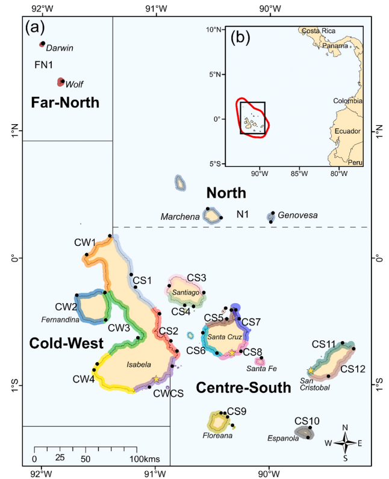

## 1. ¿Qué hace este QMD?

Este QMD descarga registros de ocurrencia de **OBIS** para un dominio geográfico y periodo definidos, los integra en una base única y aplica procesos de **depuración, validación y estandarización taxonómica, espacial y temporal**. Luego realiza un **análisis exploratorio de datos (EDA)** para describir la distribución de los registros por año, mes y grupo taxonómico, así como su cobertura y continuidad espacio-temporal. El objetivo es identificar conjuntos biológicos con información adecuada para análisis posteriores de **diversidad** y su relación con **variables oceanográficas**, manteniendo la trazabilidad de los datos y la representatividad del muestreo.

Como referencia espacial para el archipiélago de Galápagos. Esta figura muestra las cuatro bioregiones principales del archipiélago (**far-north, north, centre-south y cold-west**), los estratos geográficos definidos a lo largo de la costa y la ubicación general de Galápagos en el Pacífico Oriental Tropical.



## 2. Configuración y funciones

```{r}
#| label: setup

required <- c(
  "robis",
  "dplyr",
  "readr",
  "ggplot2",
  "tibble",
  "cowplot"
)

missing <- required[
  !vapply(required, requireNamespace, logical(1), quietly = TRUE)
]

if (length(missing) > 0L) {
  stop(
    "Instala los paquetes faltantes: install.packages(c(",
    paste(shQuote(missing), collapse = ", "),
    "))"
  )
}

root <- if (file.exists("main.R")) {
  "."
} else if (file.exists(file.path("R", "main.R"))) {
  "."
} else {
  stop("No se encontró main.R en el directorio actual")
}

root <- normalizePath(root, winslash = "/")

main_file <- if (file.exists(file.path(root, "main.R"))) {
  file.path(root, "main.R")
} else {
  file.path(root, "R", "main.R")
}

source(main_file, local = TRUE)

required_functions <- c(
  "obis_cell_accumulation_screening",
  "obis_clean_standardize",
  "obis_download_period",
  "obis_eda_tables",
  "obis_event_coverage_by_year",
  "obis_integrate_raw",
  "obis_paths",
  "obis_plot_cell_accumulation",
  "obis_plot_map_taxa",
  "obis_plot_map_years",
  "obis_plot_record_thinning",
  "obis_plot_saturation_domain",
  "obis_plot_saturation_map",
  "obis_plot_saturation_thresholds",
  "obis_plot_spatial_facets",
  "obis_rarefaction_screening",
  "obis_record_thinning_screening",
  "obis_records_saturation_screening",
  "obis_selected_years",
  "obis_spatial_screening",
  "obis_taxon_suitability",
  "obis_taxonomic_screening",
  "obis_validate_config",
  "obis_wkt",
  "obis_write_csv"
)

obis_assert_functions(
  required_functions,
  env = environment()
)

#configuración 
ggplot2::theme_set(
  cowplot::theme_cowplot(font_size = 11)
)

p <- params

obis_validate_config(p)

years <- seq.int(
  as.integer(p$year_start),
  as.integer(p$year_end)
)

paths <- obis_paths(root)
wkt <- obis_wkt(p)
lon_range <- p$lon_max - p$lon_min
lat_range <- p$lat_max - p$lat_min

grid_res <- if (!is.null(p$grid_res)) {
  as.numeric(p$grid_res)
} else {
  NA_real_
}

has_grid <- length(grid_res) == 1L &&
  is.finite(grid_res) &&
  grid_res > 0

if (has_grid) {
  n_lon <- ceiling(lon_range / grid_res)
  n_lat <- ceiling(lat_range / grid_res)
  n_cells <- n_lon * n_lat
} else {
  n_lon <- NA_integer_
  n_lat <- NA_integer_
  n_cells <- NA_integer_
}

line <- paste(rep("=", 72), collapse = "")
separator <- paste(rep("-", 72), collapse = "")

cat(
  "\n", line, "\n",
  " OBIS | CONFIGURACIÓN DEL PROYECTO\n",
  line, "\n\n",

  " 01. PROYECTO\n",
  separator, "\n",
  " Directorio raíz      : ", root, "\n",
  " Archivo de funciones : ", main_file, "\n",
  " Funciones verificadas: ", length(required_functions), "\n",
  " Tema gráfico         : cowplot::theme_cowplot()\n\n",

  " 02. DOMINIO GEOGRÁFICO\n",
  separator, "\n",
  " Longitud             : ", p$lon_min, " a ", p$lon_max, "°\n",
  " Latitud              : ", p$lat_min, " a ", p$lat_max, "°\n",
  " Extensión longitudinal: ", lon_range, "°\n",
  " Extensión latitudinal : ", lat_range, "°\n",
  " Geometría de consulta: POLYGON (WKT)\n\n",

  " 03. RESOLUCIÓN ESPACIAL\n",
  separator, "\n",
  " Resolución de grilla : ",
  if (has_grid) paste0(grid_res, "° x ", grid_res, "°") else "No definida",
  "\n",
  " Columnas             : ", if (has_grid) n_lon else "NA", "\n",
  " Filas                : ", if (has_grid) n_lat else "NA", "\n",
  " Celdas geométricas   : ",
  if (has_grid) format(n_cells, big.mark = ",", scientific = FALSE) else "NA",
  "\n\n",

  " 04. COBERTURA TEMPORAL\n",
  separator, "\n",
  " Año inicial          : ", min(years), "\n",
  " Año final            : ", max(years), "\n",
  " Años evaluados       : ", length(years), "\n\n",

  " 05. DESCARGA Y ANÁLISIS\n",
  separator, "\n",
  " Descarga OBIS        : ",
  if (isTRUE(p$execute_download)) "ACTIVADA" else "DESACTIVADA",
  "\n",
  " Rarefacción eventos  : ",
  if (isTRUE(p$run_rarefaction)) "ACTIVADA" else "DESACTIVADA",
  "\n",
  " Saturación eventos : ",
  if (!is.null(p$n_saturation_groups_per_rank)) "CONFIGURADA" else "No configurada"
)

```

## 3. Descarga e integración anual de ocurrencias

Se realiza **una consulta por año**, conservando todos los campos en OBIS en CSV, y se integran los archivos anuales mediante `dplyr::bind_rows()`.

```{r}
#| label: download
manifest <- obis_download_period(years,wkt,paths$raw,p$execute_download)
obis_write_csv(manifest,file.path(paths$tab,"00_write_descargas.csv"))
print(manifest)
```

```{r}
#| label: integrate
raw_all <- obis_integrate_raw(manifest,years,paths$raw)

if (is.null(raw_all)) {
  warning("Faltan años o existen CSV inválidos: consulta cout/obis/tab/manifest_descargas.csv")
} else {
  cat("Ocurrencias:",nrow(raw_all),"\nColumnas:",ncol(raw_all),"\n")
}
```

## 4. Depuración y estandarización

Se conservan registros georreferenciados, identificados a nivel de especie y de afinidad marina confirmada. Se excluyen fósiles, ausencias, duplicados, registros descartados por OBIS y alertas explícitas de tierra. Se revisa cada exclusión.

```{r}
#| label: clean
processed <- obis_clean_standardize(raw_all,p)

clean <- if(is.null(processed)) NULL else processed$clean

if (!is.null(processed)) {
  obis_write_csv(processed$audit,file.path(paths$tab,"01_rev_depuracion.csv"))
  obis_write_csv(dplyr::count(processed$quality,source_year,reason,name="n"),
                 file.path(paths$tab,"01_rev_por_anio.csv"))
  obis_write_csv(processed$missing_fields,file.path(paths$tab,"01_rev_campos.csv"))
  print(processed$audit)
  cat("Registros retenidos:",nrow(clean),"\n")
}
```

## 5. Evaluación de grupos taxonómicos

La selección exploratoria considera el número de especies, años representados, continuidad temporal y diversidad de conjuntos de datos, por **filo, clase, orden**.

```{r}
#| label: screening
#| 
screening <- obis_taxonomic_screening(clean,years)

if(!is.null(screening)) {
  obis_write_csv(screening$representativity,
                 file.path(paths$tab,"02_candidatos_taxonomicos.csv"))
  obis_write_csv(screening$yearly_taxa,
                 file.path(paths$tab,"02_registros_por_anio_y_taxon.csv"))
  
  print(utils::head(dplyr::arrange(screening$representativity,
                                   dplyr::desc(species),
             dplyr::desc(years_present),dplyr::desc(records)),25),n = 10)
}
```

## 6. EDA de registros

Las figuras muestran **cobertura temporal**. Las tablas de conteos incluyen todos los grupos; para visualizar la composición se presentan los doce taxones con más registros en cada rango.

La @fig-obis-anual presenta el número de ocurrencias documentadas por año, considerando todos los grupos taxonómicos retenidos después de la depuración.

```{r}
#| label: fig-obis-anual
#| fig-cap: "Distribución anual de registros de ocurrencia de biodiversidad marina en el archipiélago de Galápagos durante 1994–2025. Fuente: OBIS, datos depurados."
#| fig-width: 11
#| fig-height: 5
#| fig-align: center
#| warning: false

eda <- obis_eda_tables(clean)
obis_write_csv(eda$year_month,
                 file.path(paths$tab,"03_registros_por_anio_mes.csv"))
  
g1 <- ggplot2::ggplot(eda$yearly,ggplot2::aes(year_analysis,records)) +
    ggplot2::geom_col(fill = "#000000") +
    ggplot2::labs(
      title = NULL,x = NULL,y = "Número de registros") +
    ggplot2::scale_x_continuous(breaks = seq(1995, 2025, by = 5), expand = c(0.01, 0.01)) + 
    ggplot2::scale_y_continuous(expand = c(0, 0), limits = c(0, 11*1E3)) + 
    ggplot2::theme_bw(base_size = 12)
  
  print(g1)
  ggplot2::ggsave(file.path(paths$fig,"03_registros_por_anio.png"),g1,
                  width = 11*0.7, height = 5*0.7, dpi = 350, bg = "white")
```

La @fig-obis-anio-mes muestra la distribución de los registros de ocurrencia por año y mes, permitiendo identificar periodos de mayor documentación y posibles discontinuidades temporales en la información disponible.

```{r}
#| label: fig-obis-anio-mes
#| fig-cap: "Distribución de registros de ocurrencia de biodiversidad marina por año y mes en el archipiélago de Galápagos durante 1994–2025. Los espacios sin color indican combinaciones año-mes sin registros documentados. Fuente: OBIS, datos depurados."
#| fig-width: 11
#| fig-height: 5.5
#| fig-align: center
#| warning: false
  

  g3 <- ggplot2::ggplot(eda$year_month,
                        ggplot2::aes(year_analysis,month_analysis,fill=records)) +
    ggplot2::geom_tile(colour = "#000000", linewidth = 0.7) +
    ggplot2::scale_fill_viridis_c(option = "plasma", direction = -1) +
    ggplot2::labs(title = "OBIS: ocurrencias por año y mes", x = NULL, y = NULL, fill = "Registros") +
    ggplot2::scale_x_continuous(expand = c(0, 0)) + 
    ggplot2::scale_y_continuous(breaks = 1:12, expand = c(0, 0)) + 
    ggplot2::theme_bw(base_size = 12) + 
    ggplot2::theme(panel.grid = ggplot2::element_blank())
  
  
  print(g3)
  
  ggplot2::ggsave(file.path(paths$fig,"03_anio_mes.png"), g3,
                 width = 11*0.8, height = 5*0.7, dpi = 350, bg = "white")
```

```{r}
#| label: fig-obis-filos
#| fig-cap: "Variación anual de los registros de ocurrencia de los nueve grupos más documentados en OBIS para Galápagos durante 1994–2025. Las escalas verticales son independientes entre paneles. Fuente: OBIS, datos depurados."
#| fig-width: 10
#| fig-height: 5
#| fig-align: center
#| warning: false

  if (!is.null(screening)) {

  for (nivel in c("phylum", "class", "order")) {

    tax <- screening$yearly_taxa |>
      dplyr::filter(.data$rank == .env$nivel)

    leaders <- tax |>
      dplyr::group_by(taxon) |>
      dplyr::summarise(
        total = sum(records, na.rm = TRUE),
        .groups = "drop"
      ) |>
      dplyr::arrange(dplyr::desc(total)) |>
      dplyr::slice_head(n = 9)

   plot_data <- tax |>
  dplyr::filter(.data$taxon %in% leaders$taxon) |>
  tidyr::complete(
    taxon = leaders$taxon,
    year_analysis = seq.int(p$year_start, p$year_end),
    fill = list(records = NA_integer_)
  ) |>
  dplyr::mutate(
    taxon = factor(.data$taxon, levels = leaders$taxon)
  ) |>
  dplyr::arrange(.data$taxon, .data$year_analysis)

    if (nrow(plot_data) == 0) next

    plot <- ggplot2::ggplot(
      plot_data,
      ggplot2::aes(
        x = year_analysis,
        y = records,
        color = taxon,
        group = taxon
      )
    ) +
      ggplot2::geom_line(linewidth = 0.3) +
      ggplot2::geom_point(size = 1.5) +
      ggplot2::facet_wrap(~ taxon, scales = "free_y", ncol = 3) +
      ggplot2::labs(
        title = paste("OBIS: registros por", nivel),
        x = NULL,
        y = "Ocurrencias"
      ) +
      ggplot2::theme_bw(base_size = 18) +
      ggplot2::theme(
        strip.text = ggplot2::element_text(face = "bold"),
        plot.title = ggplot2::element_text(face = "bold")
      )

    print(plot)

    ggplot2::ggsave(
      filename = file.path(paths$fig, paste0("04_taxones_", nivel, "_facet.png")),
      plot = plot,
      width = 8,
      height = 5,
      dpi = 350, 
      bg = "white"
    )
  }
}

```

## 7. Representatividad espacial por grupo taxonómico

Se evalúa **qué tan distribuidos espacialmente están los registros** antes de seleccionar un grupo para estudiar diversidad con la cuadrícula de `grid_res` grados. Se resumen registros, celdas con observaciones y concentración espacial **por año y por filo, clase u orden**. Las celdas sin registros no se interpretan como ausencias.

```{r}
#| label: spatial-screening
spatial <- NULL
if (!is.null(clean) && nrow(clean)) {
  
  spatial <- obis_spatial_screening(
    clean = clean,
    p = p,
    grid_res = p$grid_res,
    ranks = c("phylum", "class", "order")
  )

  obis_write_csv(spatial$cell_counts,
                 file.path(paths$tab, "05_celdas_por_taxon_anio.csv"))
  obis_write_csv(spatial$annual,
                 file.path(paths$tab, "05_cobertura_espacial_taxon_anio.csv"))
  obis_write_csv(spatial$summary,
                 file.path(paths$tab, "05_cobertura_espacial_taxon_resumen.csv"))

  print(utils::head(spatial$summary, 20), n = 20)
}
```

### Distribución espacial anual por grupo

Las facetas conservan el orden de **mayor a menor número total de registros**. La primera figura muestra cuántas celdas cuentan con registros; la segunda, la proporción de registros concentrados en la celda dominante; la tercera, el promedio de registros por celda ocupada.

```{r}
#| label: fig-spatial-facets
#| fig-cap: "Variación espacio-temporal de la cobertura, concentración e intensidad documental de las nueve clases taxonómicas con mayor número de registros en Galápagos durante 1994–2025."
#| fig-subcap:
#|   - "Número de celdas geográficas con registros por año."
#|   - "Proporción de registros concentrados en la celda dominante por año."
#|   - "Número promedio de registros por celda documentada y año."
#| fig-width: 10
#| fig-height: 5
#| fig-align: center
#| warning: false


if (!is.null(spatial) && nrow(spatial$annual)) {
  for (nivel in c("class")) {
    for (metric in c("n_cells", "max_cell_share", "mean_records_per_cell")) {
      plot <- obis_plot_spatial_facets(
        annual = spatial$annual,
        rank_value = nivel,
        metric = metric,
        n_top = 9
      )
      if (is.null(plot)) next
      print(plot)
      
      ggplot2::ggsave(
        filename = file.path(paths$fig, paste0("05_espacial_", nivel, "_", metric, ".png")),
        width = 8,
      height = 5,
      dpi = 350, 
      bg = "white"
    )
    }
  }
}
```

| Clase | Cobertura espacial | Concentración | Intensidad de eventos | Evaluación |
|---------------|---------------|---------------|---------------|---------------|
| **Teleostei** | Relativamente alta | Moderada | Alta, variable | Candidato favorable |
| Malacostraca | Moderada | Moderada-alta en algunos años | Muy variable | Revisar distribución por dataset |
| Holothuroidea | Moderada en años recientes | Alta en algunos años | Picos marcados | Posible sesgo de muestreo |
| Elasmobranchii | Aumenta con el tiempo | Disminuye en años recientes | Relativamente baja | Candidato para revisar, especialmente en años recientes |
| Globothalamea | Muy baja | Extremadamente alta | Un valor inicial excepcional | Poco apropiado para análisis espacio-temporal con esta información |

## 8. Diagnóstico para seleccionar grupos

Se combinan indicadores temporales y espaciales para **comparar clases**. La evaluación incluye número de especies identificadas, años con registros, racha de continuidad, celdas observadas por año, dominancia de la celda principal y procedencia de los registros.

```{r}
#| label: integrated-screening
suitability <- NULL
if (!is.null(spatial) && !is.null(screening)) {
  suitability <- obis_taxon_suitability(
    representativity = screening$representativity,
    spatial_summary = spatial$summary
  )
  obis_write_csv(suitability,
                 file.path(paths$tab, "06_idoneidad_taxonomica_espaciotemporal.csv"))
  print(utils::head(suitability, 30), n = 10)
}
```

```{r}
#| label: select-teleostei

if (is.null(clean) || nrow(clean) == 0L) {
  stop("No existen registros depurados para seleccionar Teleostei.")
}

teleostei <- clean |>
  dplyr::filter(
    !is.na(.data$class),
    trimws(.data$class) == "Teleostei",
    !is.na(.data$species_accepted),
    trimws(.data$species_accepted) != ""
  ) |>
  dplyr::arrange(
    .data$year_analysis,
    .data$month_analysis,
    .data$species_accepted
  )

stopifnot(
  nrow(teleostei) > 0L,
  all(teleostei$class == "Teleostei"),
  all(teleostei$year_analysis %in% years)
)

file_teleostei <- file.path(
  paths$cin,
  sprintf(
    "obis_teleostei_%d_%d.csv",
    min(years),
    max(years)
  )
)

obis_write_csv(
  teleostei,
  file_teleostei
)

summary_teleostei <- tibble::tibble(
  taxon = "Teleostei",
  records = nrow(teleostei),
  species = dplyr::n_distinct(teleostei$species_accepted),
  years = dplyr::n_distinct(teleostei$year_analysis),
  first_year = min(teleostei$year_analysis),
  last_year = max(teleostei$year_analysis),
  columns = ncol(teleostei)
)

print(summary_teleostei)


teleostei_annual <- teleostei |>
  dplyr::group_by(.data$year_analysis) |>
  dplyr::summarise(
    records = dplyr::n(),
    species = dplyr::n_distinct(.data$species_accepted),
    .groups = "drop"
  ) |>
  tidyr::complete(
    year_analysis = years,
    fill = list(
      records = NA_integer_,
      species = NA_integer_
    )
  ) |>
  dplyr::arrange(.data$year_analysis)

obis_write_csv(
  teleostei_annual,
  file.path(paths$tab, "09_teleostei_resumen_anual.csv")
)

print(teleostei_annual)
```

## 9. Caracterización taxonómica de Teleostei

Se evalúa la composición taxonómica de Teleostei mediante el número de ocurrencias, riqueza registrada y continuidad temporal de sus principales órdenes, familias, géneros y especies. Esta caracterización permite identificar los grupos predominantes y orientar la selección de ensamblajes ecológicamente coherentes.

```{r}
#| label: fig-teleostei-rankings
#| fig-cap: "Principales órdenes, familias, géneros y especies de Teleostei según el número acumulado de ocurrencias en Galápagos durante 1994–2025."
#| fig-width: 10
#| fig-height: 7
#| fig-align: center
#| warning: false

tax_rank <- teleostei |>
  tidyr::pivot_longer(
    cols = c(order, family, genus, species_accepted),
    names_to = "rank",
    values_to = "taxon"
  ) |>
  dplyr::filter(!is.na(taxon), taxon != "") |>
  dplyr::count(rank, taxon, name = "records") |>
  dplyr::arrange(rank, dplyr::desc(records))

obis_write_csv(
  tax_rank,
  file.path(paths$tab, "10_teleostei_rankings.csv")
)

top_taxa <- tax_rank |>
  dplyr::group_by(rank) |>
  dplyr::slice_max(
    records, n = 10, with_ties = FALSE
  ) |>
  dplyr::ungroup() |>
  dplyr::mutate(
    rank = factor(
      rank,
      levels = c("order", "family", "genus", "species_accepted"),
      labels = c("Orden", "Familia", "Género", "Especie")
    ),
    taxon_key = paste(rank, taxon, sep = "___")
  ) |>
  dplyr::arrange(records) |>
  dplyr::mutate(
    taxon_key = factor(taxon_key, levels = unique(taxon_key))
  )

g_rank <- ggplot2::ggplot(
  top_taxa,
  ggplot2::aes(taxon_key, records, fill = rank)
) +
  ggplot2::geom_col() +
  ggplot2::facet_wrap(~ rank, scales = "free", ncol = 2) +
  ggplot2::coord_flip() +
  ggplot2::scale_x_discrete(
    labels = function(x) sub("^.*___", "", x)
  ) +
  ggplot2::labs(x = NULL, y = "Ocurrencias") +
  ggplot2::theme_bw(base_size = 15) +
  ggplot2::theme(
    strip.text = ggplot2::element_text(face = "bold")
  )

print(g_rank)

ggplot2::ggsave(
  file.path(paths$fig, "10_teleostei_rankings.png"),
  g_rank, width = 12, height = 9,
  dpi = 350, bg = "white"
)
```


## 10. Caracterización y representatividad de los grupos ecológicos de Teleostei

La diversidad de Teleostei comprende especies con diferentes afinidades de hábitat, estrategias ecológicas y patrones de distribución espacial. Por ello, se realiza una clasificación ecológica a nivel de especie para identificar ensamblajes potencialmente adecuados para estudios de diversidad y variabilidad ambiental en el archipiélago de Galápagos.

Se evalúa la representatividad de cada grupo mediante el número de ocurrencias, riqueza observada, cobertura y continuidad temporal. Este diagnóstico, complementado con los antecedentes de investigación sobre comunidades de peces arrecifales en Galápagos (Edgar et al., 2004; Bruneel et al., 2021; McKinley et al., 2022, 2023), permite sustentar la selección preliminar del ensamblaje focal.


### 10.1. Clasificación ecológica por especie

La clasificación ecológica preliminar considera la afinidad de hábitat de cada especie, tomando como fuentes de referencia FishBase, Shorefishes of the Eastern Pacific, la lista regional de peces de Galápagos (Victor et al., 2026) y los inventarios de los estudios sobre comunidades arrecifales (Edgar et al., 2004; McKinley et al., 2022, 2023).

Se establecen siete categorías ecológicas, ilustradas mediante especies representativas de cada grupo.

| Imagen representativa | Grupo ecológico | Especie representativa | Descripción |
|:---:|---|---|---|
| {width=180px} | **Arrecifal** | *Stegastes arcifrons* | Especies estrechamente asociadas a arrecifes y fondos rocosos. |
| {width=180px} | **Asociación arrecifal variable** | *Caranx melampygus* | Especies que utilizan ambientes arrecifales, pero también otros hábitats. |
| {width=180px} | **Pelágico** | *Thunnus albacares* | Especies asociadas principalmente a la columna de agua. |
| {width=180px} | **Costero generalista** | *Mugil cephalus* | Especies que utilizan diversos hábitats costeros. |
| {width=180px} | **Demersal no arrecifal** | *Bothus mancus* | Especies asociadas principalmente a fondos no arrecifales. |
| {width=180px} | **Aguas profundas** | *Diaphus theta* | Especies asociadas a ambientes mesopelágicos y otros ambientes profundos. |
| ** | **Sin clasificar** | ** | Especies cuya afinidad ecológica requiere mayor verificación. |

La clasificación presentada en la @tbl-ecological-classification permite diferenciar los principales grupos ecológicos de Teleostei y constituye la base para evaluar su representatividad taxonómica, espacial y temporal.


```{r}
#| label: teleostei-ecological-inventory

species_inventory <- teleostei |>
  dplyr::group_by(species_accepted, family, genus) |>
  dplyr::summarise(
    records = dplyr::n(),
    years = dplyr::n_distinct(year_analysis),
    first_year = min(year_analysis),
    last_year = max(year_analysis),
    .groups = "drop"
  ) |>
  dplyr::arrange(dplyr::desc(records))

habitat_file <- file.path(
  paths$cin,
  "teleostei_habitat_classification.csv"
)

if (!file.exists(habitat_file)) {

  habitat_template <- species_inventory |>
    dplyr::distinct(species_accepted) |>
    dplyr::mutate(
      ecological_group = NA_character_,
      reef_associated = NA,
      reference = NA_character_,
      classification_status = "PENDIENTE"
    )

  obis_write_csv(habitat_template, habitat_file)
}

print(species_inventory, n = 20)
```

### 10.2. Composición por grupo ecológico

Se clasifican las especies de Teleostei según su afinidad ecológica, con el propósito de comparar la representatividad de los diferentes ensamblajes presentes en la base de OBIS.

```{r}
#| label: fig-teleostei-ecological-composition
#| fig-cap: "Número de especies y registros de ocurrencia de Teleostei según su clasificación ecológica preliminar en Galápagos durante 1994–2025."
#| fig-width: 12
#| fig-height: 5
#| fig-align: center
#| warning: false

habitat <- readr::read_csv(
  file.path(paths$cin, "teleostei_habitat_classification.csv"),
  show_col_types = FALSE
)

stopifnot(!anyDuplicated(habitat$species_accepted))

teleostei_ecological <- teleostei |>
  dplyr::left_join(habitat, by = "species_accepted") |>
  dplyr::mutate(
    ecological_group = dplyr::coalesce(
      ecological_group, "Sin clasificar"
    )
  )

eco_summary <- teleostei_ecological |>
  dplyr::group_by(ecological_group) |>
  dplyr::summarise(
    records = dplyr::n(),
    species = dplyr::n_distinct(species_accepted),
    years = dplyr::n_distinct(year_analysis),
    .groups = "drop"
  ) |>
  dplyr::arrange(dplyr::desc(records))

obis_write_csv(
  eco_summary,
  file.path(paths$tab, "11_teleostei_ecological_summary.csv")
)

eco_plot <- eco_summary |>
  tidyr::pivot_longer(
    cols = c(records, species),
    names_to = "metric",
    values_to = "value"
  ) |>
  dplyr::mutate(
    metric = factor(
      metric,
      levels = c("records", "species"),
      labels = c("Ocurrencias", "Especies")
    )
  )

g_eco <- ggplot2::ggplot(
  eco_plot,
  ggplot2::aes(
    x = reorder(ecological_group, value),
    y = value,
    fill = ecological_group
  )
) +
  ggplot2::geom_col(show.legend = FALSE, col = 1) +
  ggplot2::facet_wrap(~metric, scales = "free", ncol = 2) +
  ggplot2::coord_flip() +
  ggplot2::labs(x = NULL, y = NULL) +
  ggplot2::theme_bw(base_size = 18) +
  ggplot2::theme(
    strip.text = ggplot2::element_text(face = "bold")
  )

print(g_eco)

ggplot2::ggsave(
  file.path(paths$fig, "11_teleostei_ecological_composition.png"),
  g_eco,
  width = 10, height = 5,
  dpi = 350, bg = "white"
)

print(eco_summary)
```

**Interpretación.** Los peces arrecifales concentran la mayor proporción de ocurrencias y riqueza registrada de Teleostei, seguidos por las especies con asociación arrecifal variable. Este predominio documental, junto con los antecedentes de monitoreo de comunidades arrecifales en Galápagos, sustenta preliminarmente su selección como ensamblaje focal del estudio.

### 10.3. Variación anual de ocurrencias por grupo ecológico

La @fig-teleostei-ecological-annual muestra la distribución temporal de las ocurrencias de Teleostei según su afinidad ecológica. Se evalúa la continuidad de los registros y su variabilidad interanual como criterios para seleccionar el ensamblaje focal del estudio.

```{r}
#| label: fig-teleostei-ecological-annual
#| fig-cap: "Variación anual del número de ocurrencias de Teleostei por grupo ecológico en el archipiélago de Galápagos durante 1994–2025. Las escalas verticales son independientes entre paneles. Fuente: OBIS, datos depurados y clasificación ecológica preliminar."
#| fig-width: 10
#| fig-height: 5
#| fig-align: center
#| warning: false

# Orden de los grupos por número total de registros
eco_levels <- eco_summary |>
  dplyr::arrange(dplyr::desc(records)) |>
  dplyr::pull(ecological_group)

# Resumen anual
eco_annual <- teleostei_ecological |>
  dplyr::group_by(ecological_group, year_analysis) |>
  dplyr::summarise(
    records = dplyr::n(),
    species = dplyr::n_distinct(species_accepted),
    .groups = "drop"
  ) |>
  tidyr::complete(
    ecological_group = eco_levels,
    year_analysis = years,
    fill = list(
      records = NA_integer_,
      species = NA_integer_
    )
  ) |>
  dplyr::mutate(
    ecological_group = factor(
      ecological_group,
      levels = eco_levels
    )
  ) |>
  dplyr::arrange(ecological_group, year_analysis)

# Exportación
obis_write_csv(
  eco_annual,
  file.path(paths$tab, "11_teleostei_ecological_annual.csv")
)

# Visualización
g_eco_annual <- ggplot2::ggplot(
  eco_annual,
  ggplot2::aes(
    x = year_analysis,
    y = records,
    colour = ecological_group,
    group = ecological_group
  )
) +
  ggplot2::geom_line(linewidth = 0.4, na.rm = TRUE) +
  ggplot2::geom_point(size = 1.8, na.rm = TRUE) +
  ggplot2::facet_wrap(
    ~ ecological_group,
    scales = "free_y",
    ncol = 3
  ) +
  ggplot2::scale_x_continuous(
    breaks = seq(1995, 2025, by = 10),
    limits = range(years)
  ) +
  ggplot2::scale_y_continuous(
    expand = ggplot2::expansion(mult = c(0.05, 0.10))
  ) +
  ggplot2::labs(
    x = NULL,
    y = "Número de ocurrencias"
  ) +
  ggplot2::theme_bw(base_size = 18) +
  ggplot2::theme(
    legend.position = "none",
    strip.text = ggplot2::element_text(
      face = "bold",
      size = 10
    ),
    panel.grid.minor = ggplot2::element_blank(),
    panel.spacing = grid::unit(0.8, "lines")
  )

print(g_eco_annual)

ggplot2::ggsave(
  file.path(paths$fig, "11_teleostei_ecological_annual.png"),
  plot = g_eco_annual,
  width = 10,
  height = 6,
  dpi = 350,
  bg = "white"
)
```

**Interpretación.** Los peces arrecifales presentan la mayor cantidad de ocurrencias y una elevada continuidad temporal durante 1994–2025. En contraste, los grupos pelágicos, costeros generalistas y de aguas profundas muestran menor intensidad documental o mayor discontinuidad temporal. Estos resultados favorecen preliminarmente la selección del ensamblaje arrecifal para investigaciones de largo plazo, condicionada a la evaluación de la comparabilidad del muestreo.

### 10.4. Variación anual de la riqueza observada por grupo ecológico

La @fig-teleostei-ecological-richness muestra la variación interanual del número de especies registradas por grupo ecológico, permitiendo evaluar la continuidad y representatividad taxonómica de los ensamblajes.

```{r}
#| label: fig-teleostei-ecological-richness
#| fig-cap: "Variación anual de la riqueza observada de Teleostei por grupo ecológico en el archipiélago de Galápagos durante 1994–2025. Las escalas verticales son independientes entre paneles. Fuente: OBIS, datos depurados y clasificación ecológica preliminar."
#| fig-width: 10
#| fig-height: 5
#| fig-align: center
#| warning: false

g_eco_richness <- ggplot2::ggplot(
  eco_annual,
  ggplot2::aes(
    x = year_analysis,
    y = species,
    colour = ecological_group,
    group = ecological_group
  )
) +
  ggplot2::geom_line(
    linewidth = 0.4,
    na.rm = TRUE
  ) +
  ggplot2::geom_point(
    size = 1.5,
    na.rm = TRUE
  ) +
  ggplot2::facet_wrap(
    ~ ecological_group,
    scales = "free_y",
    ncol = 3
  ) +
  ggplot2::scale_x_continuous(
    breaks = seq(1995, 2025, by = 10),
    limits = range(years)
  ) +
  ggplot2::scale_y_continuous(
    expand = ggplot2::expansion(
      mult = c(0.05, 0.10)
    )
  ) +
  ggplot2::labs(
    x = NULL,
    y = "Número de especies"
  ) +
  ggplot2::theme_bw(base_size = 18) +
  ggplot2::theme(
    legend.position = "none",
    strip.text = ggplot2::element_text(
      face = "bold",
      size = 10
    ),
    panel.grid.minor = ggplot2::element_blank(),
    panel.spacing = grid::unit(0.8, "lines")
  )

print(g_eco_richness)

ggplot2::ggsave(
  file.path(
    paths$fig,
    "11_teleostei_ecological_richness.png"
  ),
  plot = g_eco_richness,
  width = 10,
  height = 6,
  dpi = 350,
  bg = "white"
)
```

**Interpretación.** Los peces arrecifales presentan la mayor riqueza observada durante el periodo 1994–2025, registrándose generalmente entre 60 y 90 especies por año y superando las 100 especies en los años recientes. Las especies con asociación arrecifal variable constituyen el segundo grupo con mayor riqueza y continuidad temporal. En contraste, los grupos pelágicos, demersales y de aguas profundas presentan una menor riqueza anual documentada o mayor discontinuidad. Estos resultados respaldan preliminarmente la selección del ensamblaje arrecifal para posteriores análisis de diversidad y variabilidad ambiental.

### 10.5. Representatividad y continuidad temporal por grupo ecológico

Se integran indicadores de riqueza registrada, intensidad de ocurrencias y continuidad temporal para evaluar la idoneidad de los diferentes grupos ecológicos de Teleostei a largo plazo.

```{r}
#| label: tbl-teleostei-ecological-suitability
#| tbl-cap: "Indicadores de representatividad y continuidad temporal de los grupos ecológicos de Teleostei en Galápagos durante 1994–2025."
#| warning: false

eco_suitability <- eco_annual |>
  dplyr::group_by(ecological_group) |>
  dplyr::summarise(
    years_present = sum(records > 0, na.rm = TRUE),
    
    temporal_coverage = 100 * years_present / length(years),
    
    longest_run = {
      r <- rle(!is.na(records) & records > 0)
      max(c(0, r$lengths[r$values]))
    },
    
    records_mean = mean(records, na.rm = TRUE),
    
    records_cv = 100 * sd(records, na.rm = TRUE) /
      mean(records, na.rm = TRUE),
    
    richness_mean = mean(species, na.rm = TRUE),
    
    richness_min = min(species, na.rm = TRUE),
    
    richness_max = max(species, na.rm = TRUE),
    
    richness_cv = 100 * sd(species, na.rm = TRUE) /
      mean(species, na.rm = TRUE),
    
    .groups = "drop"
  ) |>
  dplyr::left_join(
    eco_summary |>
      dplyr::select(ecological_group, records, species),
    by = "ecological_group"
  ) |>
  dplyr::mutate(
    records_share = 100 * records / sum(records),
    species_share = 100 * species / sum(species)
  ) |>
  dplyr::select(
    ecological_group,
    records,
    records_share,
    species,
    species_share,
    years_present,
    temporal_coverage,
    longest_run,
    records_mean,
    records_cv,
    richness_mean,
    richness_min,
    richness_max,
    richness_cv
  ) |>
  dplyr::arrange(dplyr::desc(records))

obis_write_csv(
  eco_suitability,
  file.path(
    paths$tab,
    "11_teleostei_ecological_suitability.csv"
  )
)

knitr::kable(
  eco_suitability,
  digits = 1
)
```

**Interpretación.** Los peces arrecifales presentan la mayor representatividad (79,7 % de las ocurrencias), una riqueza acumulada de 128 especies y cobertura temporal continua durante los 32 años evaluados. Asimismo, presentan la menor variabilidad interanual relativa de la riqueza observada (CV = 18,9 %). Estos atributos, junto con los antecedentes de investigación sobre comunidades arrecifales en Galápagos, respaldan su selección como ensamblaje focal para el estudio de la diversidad y su relación con la variabilidad oceanográfica.

## 11. Caracterización espacial de Teleostei

Se examina la distribución espacial de las ocurrencias, riqueza observada y continuidad temporal de los grupos ecológicos de Teleostei mediante una cuadrícula de mayor resolución (0,05°). El objetivo es identificar patrones de concentración de ocurrencias y evaluar la cobertura geográfica de los ensamblajes presentes en el archipiélago de Galápagos.

### 11.1. Configuración espacial

```{r}
#| label: spatial-teleostei-setup
#| warning: false

p$grid_res_map <- 0.05
grid_res_map <- as.numeric(p$grid_res_map)

stopifnot(
  length(grid_res_map) == 1L,
  is.finite(grid_res_map),
  grid_res_map > 0
)

# Dominio geográfico
bbox <- sf::st_bbox(
  c(
    xmin = p$lon_min,
    ymin = p$lat_min,
    xmax = p$lon_max,
    ymax = p$lat_max
  ),
  crs = sf::st_crs(4326)
)

# Cartografía costera de Natural Earth
coast_file <- file.path(
  paths$cin, "galapagos_coast_10m.rds"
)

if (!file.exists(coast_file)) {

  land <- rnaturalearth::ne_download(
    scale = 10,
    type = "land",
    category = "physical",
    returnclass = "sf"
  )

  land <- sf::st_transform(land, 4326)

  galapagos_land <- sf::st_crop(
    land, bbox
  )

  saveRDS(galapagos_land, coast_file)

} else {

  galapagos_land <- readRDS(coast_file)

}

# Identificación de campos geográficos
lon_col <- intersect(
  c("decimalLongitude", "longitude", "lon"),
  names(teleostei_ecological)
)

lat_col <- intersect(
  c("decimalLatitude", "latitude", "lat"),
  names(teleostei_ecological)
)

stopifnot(
  length(lon_col) > 0,
  length(lat_col) > 0
)

# Asignación de ocurrencias a celdas
teleostei_grid <- teleostei_ecological |>
  dplyr::mutate(
    lon = as.numeric(.data[[lon_col[1]]]),
    lat = as.numeric(.data[[lat_col[1]]])
  ) |>
  dplyr::filter(
    is.finite(lon),
    is.finite(lat),
    lon >= p$lon_min,
    lon <= p$lon_max,
    lat >= p$lat_min,
    lat <= p$lat_max
  ) |>
  dplyr::mutate(
    cell_x = pmin(
      floor((lon - p$lon_min) / grid_res_map),
      ceiling((p$lon_max - p$lon_min) /
                grid_res_map) - 1
    ),
    cell_y = pmin(
      floor((lat - p$lat_min) / grid_res_map),
      ceiling((p$lat_max - p$lat_min) /
                grid_res_map) - 1
    ),
    lon_grid = p$lon_min +
      (cell_x + 0.5) * grid_res_map,
    lat_grid = p$lat_min +
      (cell_y + 0.5) * grid_res_map,
    cell_id = paste(cell_x, cell_y, sep = "_")
  )

# Resumen de todas las ocurrencias
grid_total <- teleostei_grid |>
  dplyr::group_by(
    cell_id, lon_grid, lat_grid
  ) |>
  dplyr::summarise(
    records = dplyr::n(),
    species = dplyr::n_distinct(species_accepted),
    years_present = dplyr::n_distinct(year_analysis),
    .groups = "drop"
  )

# Resumen por grupo ecológico
grid_ecological <- teleostei_grid |>
  dplyr::group_by(
    ecological_group,
    cell_id, lon_grid, lat_grid
  ) |>
  dplyr::summarise(
    records = dplyr::n(),
    species = dplyr::n_distinct(species_accepted),
    years_present = dplyr::n_distinct(year_analysis),
    .groups = "drop"
  ) |>
  dplyr::mutate(
    ecological_group = factor(
      ecological_group,
      levels = eco_levels
    )
  )

# Exportación de resultados espaciales
obis_write_csv(
  grid_total,
  file.path(paths$tab, "12_teleostei_grid_total.csv")
)

obis_write_csv(
  grid_ecological,
  file.path(paths$tab, "12_teleostei_grid_ecological.csv")
)

cat(
  "\n",
  "============================================\n",
  " TELEOSTEI | CONFIGURACIÓN ESPACIAL\n",
  "============================================\n",
  " Resolución     : ", grid_res_map, "°\n",
  " Registros      : ", nrow(teleostei_grid), "\n",
  " Celdas con datos: ", nrow(grid_total), "\n",
  " Especies       : ",
  dplyr::n_distinct(teleostei_grid$species_accepted),
  "\n",
  "============================================\n",
  sep = ""
)
```

```{r}
#| label: spatial-map-function
#| include: false

plot_teleostei_map <- function(
    data,
    metric,
    legend_title,
    palette = "viridis",
    transform = "identity",
    facet = FALSE,
    title = NULL
) {

  g <- ggplot2::ggplot() +

    ggplot2::geom_tile(
      data = data,
      ggplot2::aes(
        x = lon_grid,
        y = lat_grid,
        fill = .data[[metric]]
      ),
      width = grid_res_map,
      height = grid_res_map
    ) +

    ggplot2::geom_sf(
      data = galapagos_land,
      fill = "grey85",
      colour = "grey25",
      linewidth = 0.25
    ) +

    ggplot2::scale_fill_viridis_c(
      option = palette,
      direction = 1,
      trans = transform,
      name = legend_title
    ) +

    ggplot2::coord_sf(
      xlim = c(p$lon_min, p$lon_max),
      ylim = c(p$lat_min, p$lat_max),
      expand = FALSE
    ) +

    ggplot2::labs(
      title = title,
      x = NULL,
      y = NULL
    ) +

    ggplot2::theme_bw(base_size = 18) +

    ggplot2::theme(
      panel.grid.major = ggplot2::element_line(
        colour = "grey90",
        linewidth = 0.2
      ),
      panel.grid.minor = ggplot2::element_blank(),
      strip.text = ggplot2::element_text(
        face = "bold",
        size = 10
      ),
      plot.title = ggplot2::element_text(
        face = "bold",
        size = 11,
        hjust = 0.5
      ),
      legend.position = "right"
    )

  if (facet) {

    g <- g +
      ggplot2::facet_wrap(
        ~ ecological_group,
        ncol = 3
      )

  }

  return(g)
}
```

### 11.2. Distribución espacial general de Teleostei

La @fig-teleostei-spatial-total presenta la distribución geográfica acumulada de las ocurrencias, riqueza observada y años documentados de Teleostei durante el periodo de estudio.

```{r}
#| label: fig-teleostei-spatial-total
#| fig-cap: "Distribución espacial de Teleostei en Galápagos durante 1994–2025: (A) número acumulado de ocurrencias, (B) riqueza observada y (C) número de años con registros. Resolución espacial de 0,05°. Fuente: OBIS."
#| fig-width: 15
#| fig-height: 5
#| fig-align: center
#| warning: false

g_records <- plot_teleostei_map(
  data = grid_total,
  metric = "records",
  legend_title = "Registros",
  palette = "plasma",
  transform = "log1p",
  title = "Ocurrencias"
)

g_species <- plot_teleostei_map(
  data = grid_total,
  metric = "species",
  legend_title = "Especies",
  palette = "viridis",
  title = "Riqueza observada"
)

g_years <- plot_teleostei_map(
  data = grid_total,
  metric = "years_present",
  legend_title = "Años",
  palette = "magma",
  title = "Cobertura temporal"
)

g_spatial_total <- cowplot::plot_grid(
  g_records,
  g_species,
  g_years,
  ncol = 3,
  labels = c("A", "B", "C"),
  label_size = 14
)

print(g_spatial_total)

ggplot2::ggsave(
  file.path(paths$fig, "12_teleostei_spatial_total.png"),
  plot = g_spatial_total,
  width = 15,
  height = 5,
  dpi = 350,
  bg = "white"
)
```

### 11.3. Distribución espacial de ocurrencias por grupo ecológico

La @fig-teleostei-spatial-ecological permite comparar la distribución geográfica y concentración documental de los diferentes grupos ecológicos de Teleostei.

```{r}
#| label: fig-teleostei-spatial-ecological
#| fig-cap: "Distribución espacial del número acumulado de ocurrencias de Teleostei por grupo ecológico en Galápagos durante 1994–2025. Resolución espacial de 0,05°. Fuente: OBIS y clasificación ecológica preliminar."
#| fig-width: 10
#| fig-height: 8
#| fig-align: center
#| warning: false

g_eco_spatial_records <- plot_teleostei_map(
  data = grid_ecological,
  metric = "records",
  legend_title = "Registros",
  palette = "plasma",
  transform = "log1p",
  facet = TRUE
)

print(g_eco_spatial_records)

ggplot2::ggsave(
  file.path(
    paths$fig,
    "12_teleostei_ecological_spatial_records.png"
  ),
  plot = g_eco_spatial_records,
  width = 12,
  height = 10,
  dpi = 350,
  bg = "white"
)
```

### 11.4. Distribución espacial de la riqueza observada

La @fig-teleostei-spatial-richness muestra la distribución espacial del número acumulado de especies registradas por grupo ecológico.

```{r}
#| label: fig-teleostei-spatial-richness
#| fig-cap: "Distribución espacial de la riqueza observada de Teleostei por grupo ecológico en Galápagos durante 1994–2025. Resolución espacial de 0,05°. Fuente: OBIS y clasificación ecológica preliminar."
#| fig-width: 12
#| fig-height: 10
#| fig-align: center
#| warning: false

g_eco_spatial_species <- plot_teleostei_map(
  data = grid_ecological,
  metric = "species",
  legend_title = "Especies",
  palette = "viridis",
  facet = TRUE
)

print(g_eco_spatial_species)

ggplot2::ggsave(
  file.path(
    paths$fig,
    "12_teleostei_ecological_spatial_species.png"
  ),
  plot = g_eco_spatial_species,
  width = 12,
  height = 10,
  dpi = 350,
  bg = "white"
)
```

### 11.5. Cobertura temporal por celda geográfica

La @fig-teleostei-spatial-years presenta el número de años con ocurrencias documentadas por celda y grupo ecológico, permitiendo identificar áreas con documentación recurrente y evaluar su potencial para estudios de largo plazo.

```{r}
#| label: fig-teleostei-spatial-years
#| fig-cap: "Distribución espacial del número de años con ocurrencias documentadas de Teleostei por grupo ecológico en Galápagos durante 1994–2025. Resolución espacial de 0,05°. Fuente: OBIS."
#| fig-width: 12
#| fig-height: 10
#| fig-align: center
#| warning: false

g_eco_spatial_years <- plot_teleostei_map(
  data = grid_ecological,
  metric = "years_present",
  legend_title = "Años",
  palette = "magma",
  facet = TRUE
) +
  ggplot2::scale_fill_viridis_c(
    option = "magma",
    limits = c(1, length(years)),
    breaks = c(1, 5, 10, 15, 20, 25, 30, 32),
    name = "Años"
  )

print(g_eco_spatial_years)

ggplot2::ggsave(
  file.path(
    paths$fig,
    "12_teleostei_ecological_spatial_years.png"
  ),
  plot = g_eco_spatial_years,
  width = 12,
  height = 10,
  dpi = 350,
  bg = "white"
)
```

## 12. Selección del ensamblaje de peces arrecifales

Los peces arrecifales y las especies con asociación arrecifal variable fueron seleccionados por su elevada representatividad taxonómica, espacial y temporal. En conjunto, concentran 58 781 ocurrencias correspondientes a 221 especies, representando el 91,2 % de los registros de Teleostei y cubriendo la totalidad del periodo 1994–2025.

Esta selección es coherente con los antecedentes de investigación sobre comunidades arrecifales, diversidad funcional y biogeografía marina del archipiélago de Galápagos (Edgar et al., 2004; McKinley et al., 2022, 2023).

```{r}
#| label: select-reef-fishes
#| warning: false

reef_groups <- c(
  "Arrecifal",
  "Asociacion arrecifal variable"
)

reef_fishes <- teleostei_ecological |>
  dplyr::filter(
    ecological_group %in% reef_groups
  ) |>
  dplyr::mutate(
    ecological_group = factor(
      ecological_group,
      levels = reef_groups
    )
  ) |>
  dplyr::arrange(
    year_analysis,
    month_analysis,
    species_accepted
  )

stopifnot(nrow(reef_fishes) > 0)

reef_summary <- reef_fishes |>
  dplyr::group_by(ecological_group) |>
  dplyr::summarise(
    records = dplyr::n(),
    species = dplyr::n_distinct(species_accepted),
    families = dplyr::n_distinct(family, na.rm = TRUE),
    years = dplyr::n_distinct(year_analysis),
    first_year = min(year_analysis),
    last_year = max(year_analysis),
    .groups = "drop"
  )

file_reef <- file.path(
  paths$cin,
  sprintf(
    "obis_reef_fishes_%d_%d.csv",
    min(years),
    max(years)
  )
)

obis_write_csv(reef_fishes, file_reef)

obis_write_csv(
  reef_summary,
  file.path(paths$tab, "13_reef_fishes_summary.csv")
)

print(reef_summary)

cat(
  "\n",
  "============================================\n",
  " OBIS | ENSAMBLAJE FOCAL SELECCIONADO\n",
  "============================================\n",
  " Ocurrencias : ", nrow(reef_fishes), "\n",
  " Especies    : ",
  dplyr::n_distinct(reef_fishes$species_accepted), "\n",
  " Familias    : ",
  dplyr::n_distinct(reef_fishes$family, na.rm = TRUE), "\n",
  " Años        : ",
  dplyr::n_distinct(reef_fishes$year_analysis), "\n",
  " Archivo     : ", file_reef, "\n",
  "============================================\n",
  sep = ""
)
```

## 13. Estructura y continuidad del proyecto

El proyecto se organiza en cinco etapas, desde la adquisición y selección de registros de biodiversidad marina hasta la evaluación de las relaciones entre la diversidad de peces arrecifales y la variabilidad oceanográfica del archipiélago de Galápagos.

| Etapa | Documento | Objetivo | Producto principal |
|------------------|------------------|------------------|------------------|
| **01** | `01_obis_seleccion_taxonomica.qmd` | Adquisición, depuración, análisis exploratorio y selección del ensamblaje arrecifal. | Base estandarizada de ocurrencias de peces arrecifales y especies con asociación arrecifal variable. |
| **02** | `02_reef_fishes_characterization.qmd` | Caracterización taxonómica, espacial, temporal y metodológica del ensamblaje seleccionado. | Base analítica con unidades de muestreo comparables, estaciones, eventos y bioregiones. |
| **03** | `03_reef_fishes_diversity.qmd` | Evaluación de la completitud del muestreo, rarefacción, diversidad alfa y beta, recambio de especies y anidamiento. | Indicadores de diversidad taxonómica y cambios en la composición de los ensamblajes. |
| **04** | `04_reef_fishes_oceanography.qmd` | Caracterización de la variabilidad oceanográfica y extracción espacio-temporal de covariables ambientales. | Base integrada de variables oceanográficas asociadas a las unidades de muestreo. |
| **05** | `05_reef_fishes_environment.qmd` | Evaluación de las relaciones entre diversidad, composición comunitaria y variabilidad ambiental mediante modelos estadísticos. | Modelos ecológicos, evaluación de hipótesis y resultados para la elaboración del artículo científico. |

: Estructura del proyecto sobre la diversidad de peces arrecifales y su relación con la variabilidad oceanográfica en el archipiélago de Galápagos.


```{mermaid}
%%| label: fig-project-workflow
%%| fig-cap: "Flujo metodológico del proyecto de investigación."
%%| fig-width: 8
%%| fig-align: center
%%| echo: false

flowchart TD

    A["QMD 01 - Adquisición y selección taxonómica"]
    B["QMD 02 - Caracterización del ensamblaje arrecifal"]
    C["QMD 03 - Evaluación de la diversidad"]
    D["QMD 04 - Caracterización oceanográfica"]
    E["QMD 05 - Modelamiento ecológico-ambiental"]

    A --> B
    B --> C
    B --> D
    C --> E
    D --> E

    style A fill:#D4EFDF,stroke:#196F3D,color:#000000
    style B fill:#F2F3F4,stroke:#566573,color:#000000
    style C fill:#F2F3F4,stroke:#566573,color:#000000
    style D fill:#F2F3F4,stroke:#566573,color:#000000
    style E fill:#D6EAF8,stroke:#21618C,color:#000000
```


### Referencias

- Bonnet-Lebrun, A.-S., Sweetlove, M., Griffiths, H. J., Sumner, M., Provoost, P., Raymond, B., Ropert-Coudert, Y., & Van de Putte, A. P. (2023). Opportunities and limitations of large open biodiversity occurrence databases in the context of a Marine Ecosystem Assessment of the Southern Ocean. *Frontiers in Marine Science, 10*, Article 1150603. https://doi.org/10.3389/fmars.2023.1150603

- Bruneel, S., Van Echelpoel, W., Ho, L., Raat, H., Schoeters, A., De Troyer, N., Sor, R., Ponton-Cevallos, J., Vandeputte, R., Van der Heyden, C., De Saeyer, N., Forio, M. A. E., Bermudez, R., Dominguez-Granda, L., Luca, S., Moens, T., & Goethals, P. (2021). Assessing the drivers behind the structure and diversity of fish assemblages associated with rocky shores in the Galapagos Archipelago. *Journal of Marine Science and Engineering, 9*(4), Article 375. https://doi.org/10.3390/jmse9040375

- Chao, A., & Jost, L. (2012). Coverage-based rarefaction and extrapolation: Standardizing samples by completeness rather than size. *Ecology, 93*(12), 2533–2547. https://doi.org/10.1890/11-1952.1

- Edgar, G. J., Banks, S., Fariña, J. M., Calvopiña, M., & Martínez, C. (2004). Regional biogeography of shallow reef fish and macro-invertebrate communities in the Galapagos archipelago. *Journal of Biogeography, 31*(7), 1107–1124. https://doi.org/10.1111/j.1365-2699.2004.01055.x

- Froese, R., & Pauly, D. (Eds.). (s. f.). *FishBase*. World Wide Web electronic publication. https://www.fishbase.org

- Fundación Charles Darwin. (2023). *Galapagos Subtidal Biodiversity* \[Conjunto de datos de ocurrencias\]. Global Biodiversity Information Facility (GBIF). https://doi.org/10.15468/gsa458

- Fundación Charles Darwin. (s. f.). *Galapagos Species Database*. DataZone. https://datazone.darwinfoundation.org/es/checklist/

- Hsieh, T. C., Ma, K. H., & Chao, A. (2016). iNEXT: An R package for rarefaction and extrapolation of species diversity (Hill numbers). *Methods in Ecology and Evolution, 7*(12), 1451–1456. https://doi.org/10.1111/2041-210X.12613

- McKinley, S. J., Saunders, B. J., Rastoin-Laplane, E., Salinas-de-León, P., & Harvey, E. S. (2022). Functional diversity of reef fish assemblages in the Galapagos Archipelago. *Journal of Experimental Marine Biology and Ecology, 549*, Article 151695. https://doi.org/10.1016/j.jembe.2022.151695

- McKinley, S. J., Saunders, B. J., Rastoin-Laplane, E., Salinas-de-León, P., & Harvey, E. S. (2023). Functional vulnerability and biogeography of reef fish assemblages in the Galapagos Archipelago. *Estuarine, Coastal and Shelf Science, 286*, Article 108301. https://doi.org/10.1016/j.ecss.2023.108301

- Menegotto, A., & Rangel, T. F. (2018). Mapping knowledge gaps in marine diversity reveals a latitudinal gradient of missing species richness. *Nature Communications, 9*, Article 4713. https://doi.org/10.1038/s41467-018-07217-7

- Moity, N. (2019). *Marine bioregions for coastal subtidal shallow rocky reef of the Galapagos Archipelago, GIS layer for Edgar et al. 2004* \[Conjunto de datos geoespaciales\]. PANGAEA. https://doi.org/10.1594/PANGAEA.907105

- Mora, C., Tittensor, D. P., & Myers, R. A. (2008). The completeness of taxonomic inventories for describing the global diversity and distribution of marine fishes. *Proceedings of the Royal Society B: Biological Sciences, 275*, 149–155. https://doi.org/10.1098/rspb.2007.1315

- Natural Earth. (s. f.). *Natural Earth: 1:10m physical vectors – Land* \[Conjunto de datos cartográficos\]. https://www.naturalearthdata.com

- Ocean Biodiversity Information System (OBIS). (s. f.). *Data access*. En *The OBIS manual*. https://manual.obis.org/access

- Ocean Biodiversity Information System (OBIS). (s. f.). *Data quality flags*. En *The OBIS manual*. https://manual.obis.org/dataquality.html

- Ocean Biodiversity Information System (OBIS). (s. f.). *Constructing and using identifiers*. En *The OBIS manual*. https://manual.obis.org/identifiers.html

- Ocean Biodiversity Information System (OBIS). (s. f.). *Occurrence: Get occurrence records*. En *robis reference*. https://iobis.github.io/robis/reference/occurrence.html

- Rastoin-Laplane, E., Salinas-de-León, P., Goetze, J. S., Saunders, B. J., McKinley, S. J., Norris, C., Gosby, C., Mattingly, A., Garcia, R., & Harvey, E. S. (2023). Fluctuations of Galapagos mid-water and benthic reef fish populations during the 2015–16 ENSO. *Estuarine, Coastal and Shelf Science, 294*, Article 108523. https://doi.org/10.1016/j.ecss.2023.108523

- Riofrío-Lazo, M., Zetina-Rejón, M. J., Vaca-Pita, L., Murillo-Posada, J. C., & Páez-Rosas, D. (2022). Fish diversity patterns along coastal habitats of the southeastern Galapagos archipelago and their relationship with environmental variables. *Scientific Reports, 12*, Article 3604. https://doi.org/10.1038/s41598-022-07601-w

- Saeedi, H. (2026). Gaps and drivers of global marine animal biodiversity from the surface to abyss. *Nature Communications, 17*, Article 4553. https://doi.org/10.1038/s41467-026-73613-z

- Smithsonian Tropical Research Institute (STRI). (s. f.). *Shorefishes of the Eastern Pacific: Online information system*. https://biogeodb.stri.si.edu/sftep/en/pages/generalinfo

- Vandepitte, L., Bosch, S., Tyberghein, L., Waumans, F., Vanhoorne, B., Hernandez, F., De Clerck, O., & Mees, J. (2015). Fishing for data and sorting the catch: Assessing the data quality, completeness and fitness for use of data in marine biogeographic databases. *Database, 2015*, Article bau125. https://doi.org/10.1093/database/bau125

- Victor, B. C., Grove, J. S., Long, D. J., Robertson, D. R., Keith, I., Bensted-Smith, W., & Salinas-de-Leon, P. (2026). List of fishes of the Galapagos Archipelago, Ecuador (Version 3.0). *Journal of the Ocean Science Foundation, 46*, 15–62. https://doi.org/10.5281/zenodo.20483239

- WoRMS Editorial Board. (s. f.). *World Register of Marine Species*. https://www.marinespecies.org
